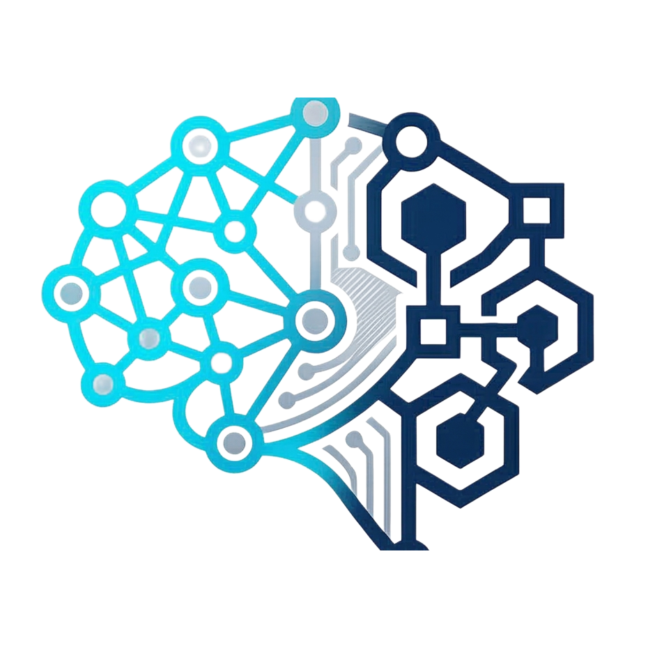

  

# AI-ML Collaborative

**Fostering cross-disciplinary innovation in AI/ML research.**

The AI-ML Collaborative is a cross-disciplinary group based at New York University that bridges the gap between rapid technological innovation and academic research application. We unite technical experts with domain researchers so that AI and machine learning are not just theoretical concepts, but practical tools that accelerate impactful, translational research in healthcare, mental health, and the behavioral sciences.

## Why this group, why now

AI/ML methods are evolving faster than researchers can apply them effectively, and research adoption has not kept pace with innovation. AI/ML is now central to research across healthcare domains, unlocking insights from complex clinical, behavioral, and population data. Real impact requires integrated domain and technical collaboration, and a working exchange between academia and industry that bridges theory and practice.

Our mission is to build digital fluency among NYU researchers, in a low-stakes, high-brainpower environment where members can:

- **Bridge silos:** connect domain experts (clinicians and researchers) with technical talent (data scientists and engineers).
- **Accelerate innovation:** move beyond traditional methods to enable data-driven discovery and predictive modeling.
- **Translate research:** make sure AI/ML solutions are clinically meaningful, ethical, and reproducible.

## Goals

- **Research advancement:** support researchers in using the latest AI and ML tools and techniques to advance their research.
- **Education and training:** train researchers, graduate students, and faculty in AI/ML tools, platforms, and analytics applications, moving members from consumers to implementers of AI.
- **Knowledge synthesis:** bridge the gap between theoretical ML papers and deployable code.
- **Community building:** vet ideas together, solve shared problems in data infrastructure, model scaling, and algorithmic bias, and seed high-impact projects that lead to publications, grant applications (NIH, NSF), and deployable digital health solutions.

## How we work

Sessions follow a simple rhythm:

- **The Pulse (opening segment):** a rapid review of the top AI papers and tool releases, keeping members at the cutting edge. Pulse briefs are collected in the [AI Pulse](AI%20Pulse) folder.
- **Core session:** alternating formats. *Whiteboarding* sessions are internal peer-critique sessions where researchers present roadblocks, data challenges, or project ideas for group feedback. *Masterclasses* bring in industry and external experts to demo specific technologies, such as large language models, synthetic data, or fine-tuning strategies.
- **Real-world case studies:** practical work applying ML to live research datasets, from global mental health trials in low-resource settings to precision health and emergency preparedness.
- **Open discussion and action items:** Q&A and planning for next steps.

Between sessions, members stay connected through a shared digital hub with channels for announcements, new papers, code snippets, LaTeX help, and the session archive.

### The skills and resources inventory

Members map what they bring and what they need: technical proficiencies (Python, PyTorch, TensorFlow and JAX, the Hugging Face ecosystem, LLM prompting and RAG, cloud compute on AWS, GCP, and Azure, LaTeX, and hardware and CUDA optimization), their hardware and compute access, and the one technical thing they could teach someone else in 15 minutes. The inventory works as a matchmaker, pairing members who are learning a tool with members who can teach it; as a schedule builder, surfacing the topics the group most wants; and as a gap check, showing where the group needs shared resources, such as GPU access.

The Collaborative meets on Zoom on Mondays, 12:00 to 1:00 PM ET. Agendas, flyers, and notes live in the [Meeting notes & info](Meeting%20notes%20%26%20info) folder, and the group's library of books and reference materials is in [Resources](Resources).

## Season 2 schedule (2026-27)

| Date | Session |
| --- | --- |
| Mon, Nov 16, 2026 | Season 2 Kickoff: The Year Ahead in Applied AI and ML |
| Mon, Dec 14, 2026 | Sherry Marcus, Head of AI at Tradeweb: AI in Production at Enterprise Scale |
| Mon, Jan 11, 2027 | Doing Analysis with AI |
| Mon, Feb 8, 2027 | Agentic AI |
| Mon, Mar 15, 2027 | Agent Swarms |
| Mon, Apr 12, 2027 | World Health Models |
| Mon, May 17, 2027 | World Mental Health Models |
| Mon, Jun 14, 2027 | Member Showcase and Season Close |

## Leadership

The Collaborative is co-led by:

- **Besa H. Bauta, Ph.D., MPH, MSW** (NYU Silver School of Social Work). Former CIO, CISO, CCO, and CDAO overseeing digital strategy and data assets for organizations with budgets up to $2.6 billion; expert in ambient AI, machine learning, and NLP for healthcare decision-making; founder of the Social Impact AI Lab (SIAIL).
- **Keng-Yen Huang, Ph.D., MPH** (NYU Grossman School of Medicine). Professor of Population Health and Child and Adolescent Psychiatry; principal investigator on NIH-funded projects across Uganda, Nepal, Ghana, and Kenya; expert in pediatric mental health, health equity, and implementation science in low-resource settings.
- **Hyungrok Do, Ph.D.** (NYU Grossman School of Medicine). Biostatistician working on machine learning for complex medical data, algorithmic fairness, survival analysis, and electronic health record data.

Members include faculty, researchers, biostatisticians, post-doctoral fellows, graduate students, technologists, and AI/ML practitioners, along with industry partners who have deployed AI/ML tools in real-world settings.

## Get involved

We are looking for members who are eager to both learn and contribute. Researchers, students, and practitioners interested in joining or presenting can contact Besa Bauta at Besa.Bauta@nyu.edu. New members complete a short skills and resources inventory so the group can match them with collaborators and shape sessions around the group's interests.

Our sister group, the NYU AI-ML Papers Group, meets weekly to read and discuss papers: https://github.com/NYU-AI-ML-Papers-Group
